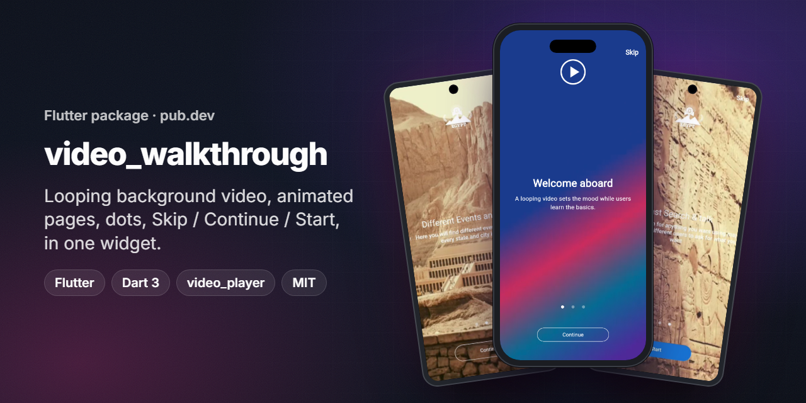
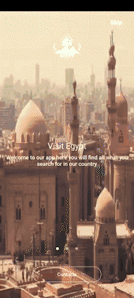
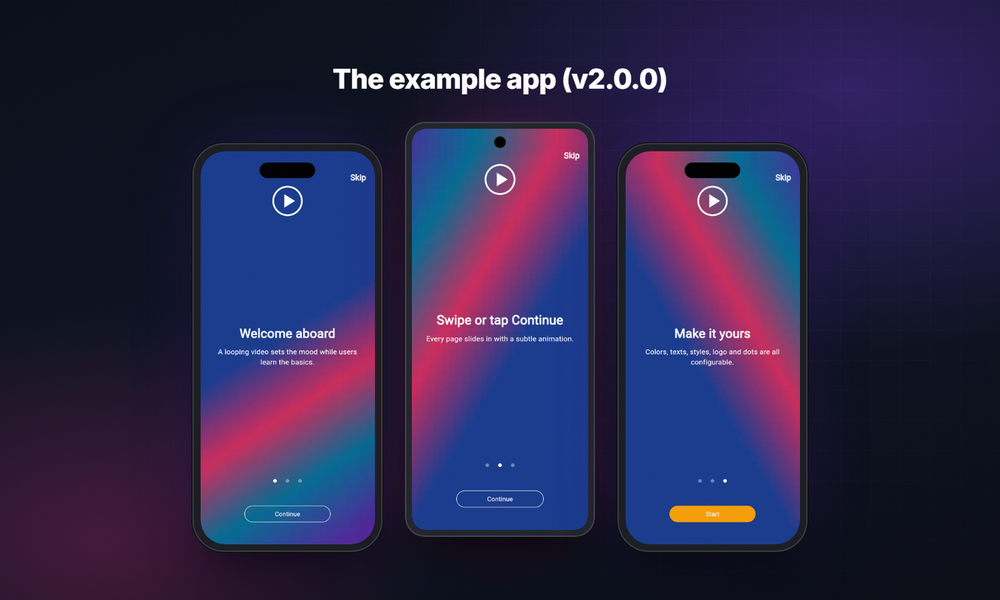
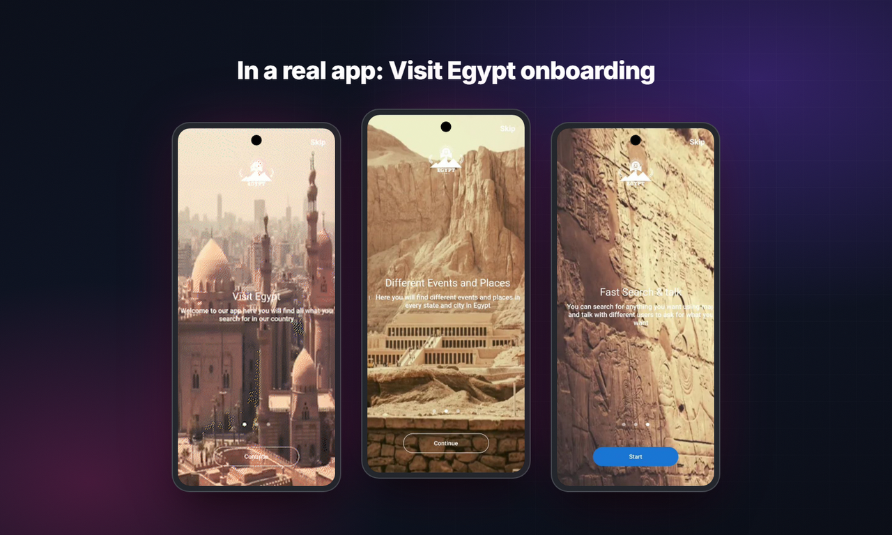
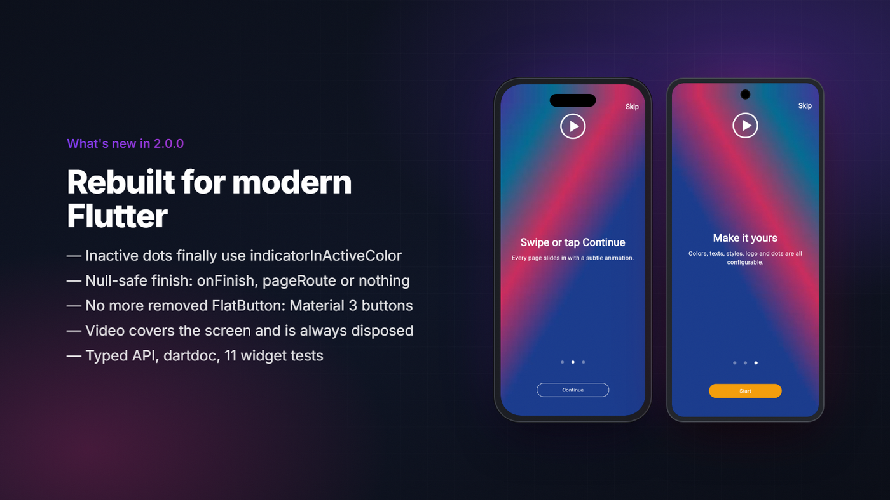
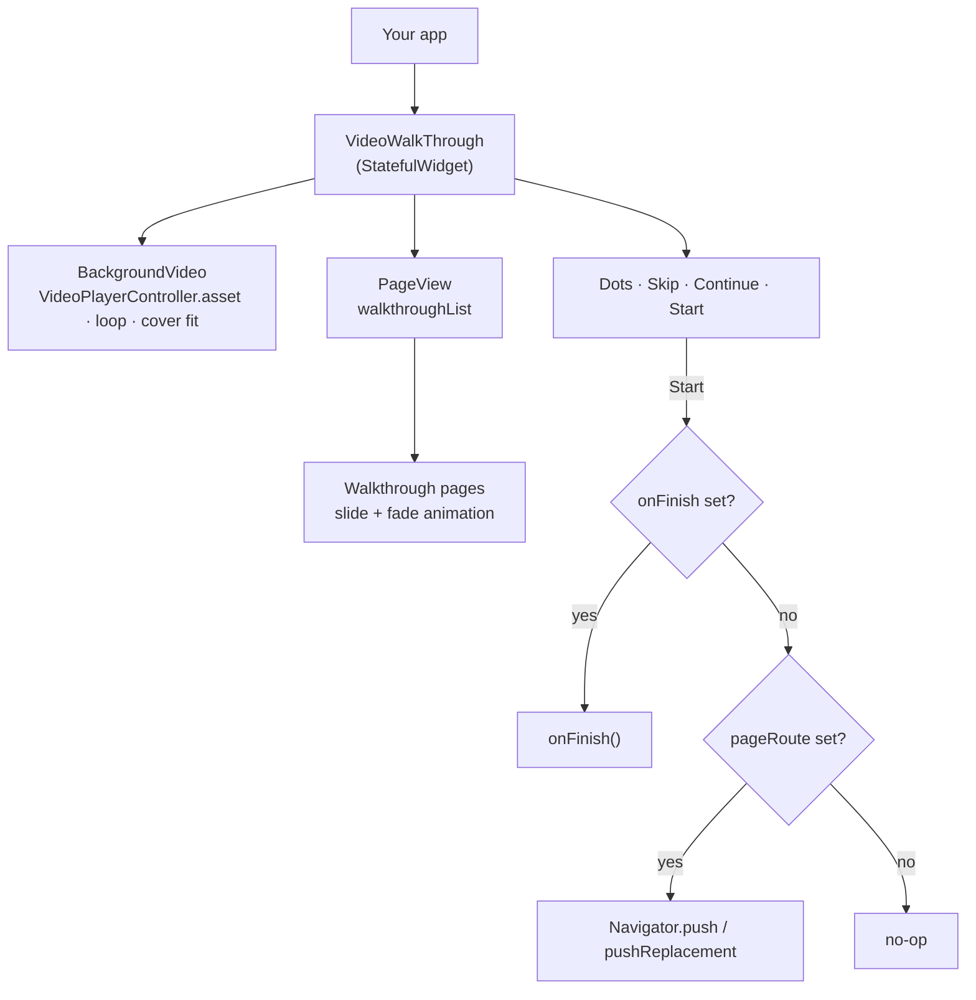

<p align="center"></p>
<h1 align="center">video_walkthrough</h1>
<p align="center"><b>Video-backed onboarding for Flutter: a looping background video, animated pages, dots, and Skip / Continue / Start in one widget.</b></p>
<p align="center">
  <a href="https://pub.dev/packages/video_walkthrough"></a>
  
  
  
  
  <a href="LICENSE"></a>
</p>

> ℹ️ **Version note.** This repository holds **2.0.0**, a modernized rewrite of the package I first published in 2022 from my
> older GitHub account [`ANaSHaKerr`](https://github.com/ANaSHaKerr/video_walkthrough). pub.dev still serves **1.0.1**, and its
> homepage link still points to that old repository until 2.0.0 is published.

## Overview

`video_walkthrough` turns an onboarding flow into a single widget. You give it an asset video and a list of pages; it plays the
video full-screen on a loop, lays your pages over it in a swipeable `PageView`, and handles the dots, the **Skip** shortcut, the
**Continue** button and the final **Start** action.

It was first used for the onboarding of *Visit Egypt*, a tourism app (screenshots below), and published on pub.dev in 2022.
**My role:** author and maintainer: API design, implementation, publishing on pub.dev, and this 2.0.0 rewrite.

## Demo

<p align="center">
  
  &nbsp;&nbsp;
  
</p>
<p align="center"><sub>Left: the original 2022 demo recording. Right: the 2.0.0 example app (Flutter web build, captured in headless Chrome).</sub></p>

## Highlights

- 🎬 **Background video**: any asset video, looping, cover-fitted, with volume and zoom controls.
- 📖 **Animated pages**: `Walkthrough` pages slide and fade in; or pass any widgets you like.
- ⏭️ **Skip, Continue, Start**: Skip jumps to the last page, Continue animates forward, Start finishes the flow.
- 🎨 **Fully themable**: texts, text styles, button colors, dot size and colors, optional logo with tint.
- 🧭 **Flexible finish**: an `onFinish` callback, or a `pageRoute` that is pushed or replaces the walkthrough.
- 🛡️ **Safe by default**: missing videos fall back to a solid color, system bars are restored on dispose, nothing force-unwraps.

## Screens

<p align="center"></p>
<p align="center"><sub>Production use: the Visit Egypt onboarding (screens from the original 1.x README).</sub></p>

## What's new in 2.0.0

<p align="center"></p>

| Before (1.0.1) | After (2.0.0) |
|---|---|
| Inactive dots were painted with `indicatorActiveColor` | Inactive dots use `indicatorInActiveColor` (covered by a test) |
| **Start** without a `pageRoute` crashed on `pageRoute!` | `onFinish` → `pageRoute` → no-op, never a null crash |
| Used `FlatButton`, which no longer exists in Flutter 3 | `TextButton`, `OutlinedButton`, `ElevatedButton` |
| Page animation was built but never applied | Pages slide and fade in |
| Controller listener never attached; `dispose` force-unwrapped | Controller awaited, errors handled, always disposed |
| Untyped `Walkthrough` fields, no docs, no tests | Typed API, dartdoc everywhere, 11 widget tests |

See the full [CHANGELOG](CHANGELOG.md), including the breaking changes.

## Getting started

```yaml
dependencies:
  video_walkthrough: ^2.0.0   # until 2.0.0 is on pub.dev, use the git dependency below
```

```yaml
dependencies:
  video_walkthrough:
    git:
      url: https://github.com/ANaSHaker/video_walkthrough.git
```

Declare your video (and optional logo) as assets:

```yaml
flutter:
  assets:
    - assets/intro.mp4
    - assets/logo.png
```

`video_player` needs no extra setup for local assets. For other sources, see the
[video_player docs](https://pub.dev/packages/video_player).

## Usage

```dart
import 'package:flutter/material.dart';
import 'package:video_walkthrough/video_walkthrough.dart';

class Onboarding extends StatelessWidget {
  const Onboarding({super.key});

  @override
  Widget build(BuildContext context) {
    return VideoWalkThrough(
      video: 'assets/intro.mp4',
      volume: 0,
      smallImage: 'assets/logo.png',
      walkthroughList: const [
        Walkthrough(title: 'Welcome aboard', content: 'A looping video sets the mood.'),
        Walkthrough(title: 'Swipe or tap Continue', content: 'Pages slide in one by one.'),
        Walkthrough(title: 'Make it yours', content: 'Every color and text is configurable.'),
      ],
      onFinish: () => Navigator.of(context).pushReplacementNamed('/home'),
    );
  }
}
```

A complete, runnable app lives in [`example/lib/main.dart`](example/lib/main.dart).

## API

### `VideoWalkThrough`

| Parameter | Type | Default | Description |
|---|---|---|---|
| `walkthroughList` | `List<Widget>` | **required** | Pages, usually `Walkthrough` widgets. Must not be empty. |
| `video` | `String` | **required** | Asset path of the background video. |
| `onFinish` | `VoidCallback?` | `null` | Called when **Start** is tapped. Takes precedence over `pageRoute`. |
| `pageRoute` | `Route<Object?>?` | `null` | Opened on **Start** when `onFinish` is null. |
| `replaceOnFinish` | `bool` | `false` | Replace the walkthrough with `pageRoute` instead of pushing it. |
| `volume` | `double` | `1.0` | Video volume, 0.0 to 1.0. |
| `videoScale` | `double` | `1.0` | Extra zoom on top of the cover fit. |
| `dotSize` | `double` | `8.0` | Indicator dot diameter. |
| `indicatorActiveColor` | `Color` | `Colors.white` | Current page dot. |
| `indicatorInActiveColor` | `Color` | `Colors.white54` | Other dots. |
| `skipText` / `skipStyle` | `String` / `TextStyle?` | `'Skip'` | Top-end skip button. |
| `continueText` / `continueStyle` | `String` / `TextStyle?` | `'Continue'` | Next-page button. |
| `continueBorderColor` | `Color` | `Colors.white` | Continue button border. |
| `startText` / `startStyle` | `String` / `TextStyle?` | `'Start'` | Last-page button. |
| `startBtnColor` | `Color` | `Colors.indigoAccent` | Start button background. |
| `smallImage` | `String?` | `null` | Optional asset image above the pages (e.g. a logo). |
| `smallImageSize` | `double` | `100` | Width of `smallImage`. |
| `smallImageColor` | `Color?` | `Colors.white` | Tint for `smallImage`; `null` keeps original colors. |
| `backgroundColor` | `Color` | `Colors.black` | Shown while the video loads or if it fails. |
| `hideSystemOverlays` | `bool` | `true` | Hide status/navigation bars; restored on dispose. |

### `Walkthrough`

| Parameter | Type | Default | Description |
|---|---|---|---|
| `title` | `String` | **required** | Page headline. |
| `content` | `String` | **required** | Page body text. |
| `titleStyle` / `contentStyle` | `TextStyle?` | white 24 / white 16 w500 | Text styles. |
| `textAlign` | `TextAlign` | `center` | Alignment of both texts. |
| `animationDuration` | `Duration` | 500 ms | Slide-in duration. |

## Architecture



| Layer | Tech |
|---|---|
| Widgets | Flutter Material 3 (`PageView`, `AnimatedContainer`, button themes) |
| Video | [`video_player`](https://pub.dev/packages/video_player) asset controller |
| Animation | `AnimationController` + `AnimatedBuilder` (translate + fade) |
| Tests | `flutter_test` with an in-memory fake `VideoPlayerPlatform` |
| Lints | `flutter_lints` |

## Project structure

```
video_walkthrough/
├── lib/
│   ├── video_walkthrough.dart      # public library: exports VideoWalkThrough + Walkthrough
│   ├── walkthrough.dart            # 1.x-compatible import (re-exports Walkthrough)
│   └── src/
│       ├── video_walkthrough.dart  # the onboarding widget
│       ├── walkthrough.dart        # animated page
│       └── background_video.dart   # looping, cover-fitted video layer (internal)
├── test/
│   ├── video_walkthrough_test.dart
│   └── fake_video_player_platform.dart
├── example/                        # runnable app (Android, iOS, Web)
└── assets/                         # README images (+ _src/render.json that produced them)
```

## Engineering notes

- **Testing a video widget without a device.** Widget tests swap `VideoPlayerPlatform.instance` for an in-memory fake that
  reports an initialized 1080×1920 video, so tests can assert that the asset is created, looped, played at the requested volume and
  disposed, with no platform channels involved.
- **The dot-color regression is locked down.** Each dot carries a stable key, and a test checks the active and inactive colors
  before and after paging.
- **Null-safety without surprises.** `pageRoute!` was replaced by an explicit order: `onFinish`, then `pageRoute`, then no-op.
- **Failure is quiet for users, loud for developers.** If the video cannot load, the walkthrough still works over
  `backgroundColor`, and the error is reported with `debugPrint`.
- **Real screenshots, no mockups of fake UI.** The example screens above come from `flutter build web` of `example/`,
  driven in headless Chrome over the DevTools protocol (tapping *Continue* between captures).

## Development

```bash
flutter pub get
flutter analyze   # No issues found
flutter test      # 11 tests passing
cd example && flutter run
```

## Contributing

Issues and pull requests are welcome. Please run `dart format .`, `flutter analyze` and `flutter test` before opening a PR,
and add a test for any bug you fix.

## License

[MIT](LICENSE) © 2022-2026 Mahmoud Shaker

## بالعربي

**video_walkthrough** باكدج Flutter منشورة على pub.dev لعمل شاشات تعريف (Onboarding) فوق فيديو خلفية بيتكرر تلقائيًا،
مع صفحات متحركة ونقاط مؤشر وأزرار تخطي/متابعة/ابدأ، كلها في ويدجت واحدة.
اتنشرت أول مرة سنة 2022 واستُخدمت في تطبيق *Visit Egypt*، وفي الإصدار 2.0.0 أعدت كتابتها لتعمل على Flutter 3 و Dart 3:
إصلاح لون النقاط غير النشطة، إزالة الـ force-unwrap على `pageRoute`، API واضح موثّق، و 11 اختبار ويدجت.
ملاحظة: صفحة الباكدج على pub.dev لسه بتشاور على الريبو القديم لحد ما يتنشر الإصدار الجديد.

## Links

- pub.dev: <https://pub.dev/packages/video_walkthrough>
- Original repository (1.x): <https://github.com/ANaSHaKerr/video_walkthrough>

---
<h3 align="center">Built by Mahmoud Shaker — Senior Flutter Engineer</h3>
<p align="center">
  <a href="https://wa.me/201140279111"></a>
  <a href="https://www.linkedin.com/in/anashaker/"></a>
  <a href="https://anashaker.github.io/shaker_portfolio/"></a>
  <a href="mailto:mahmoudshaker382001@gmail.com"></a>
  <a href="https://khamsat.com/user/sheko201566"></a>
  <a href="https://mostaql.com/u/ShekoShaker"></a>
  <a href="https://github.com/ANaSHaker"></a>
</p>
